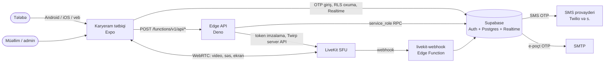
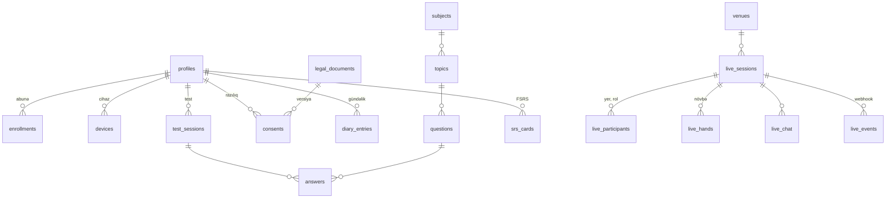
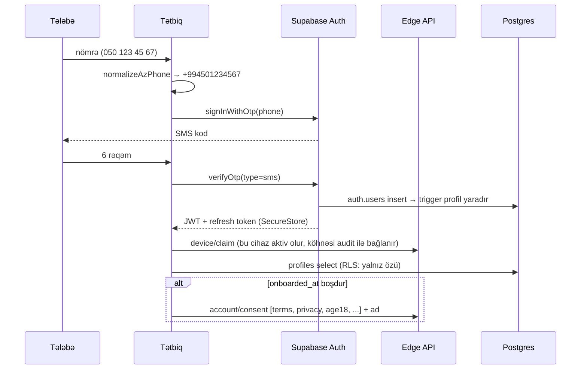
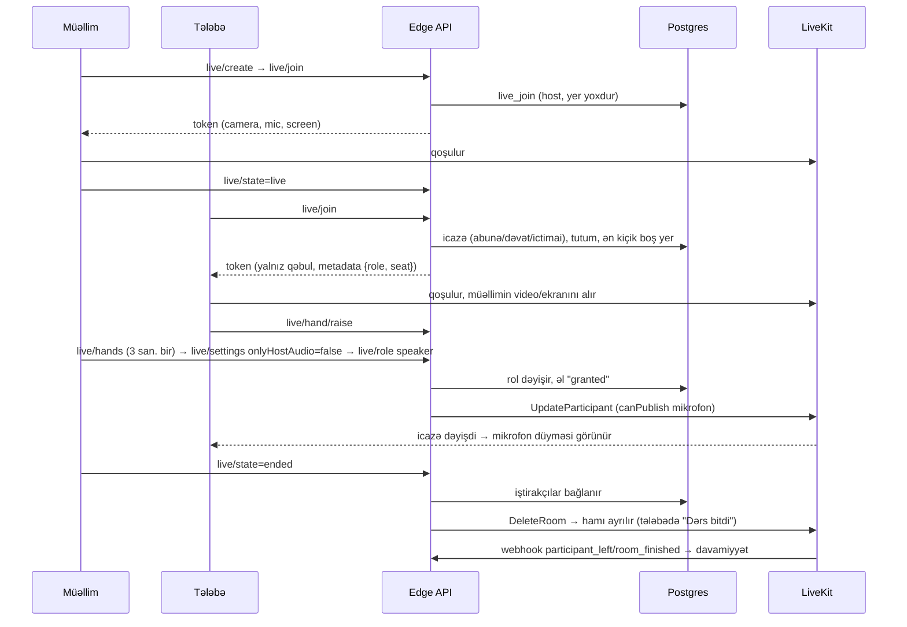

# Arxitektura

Versiya 0.3 · 2026-11-04. Burada yalnız repoda olan və ya açıq şəkildə "Plan" yazılan şeylər təsvir olunur.

Karyeram Accademy iki rejimli virtual məktəbdir:

1. **Özünü öyrənmə otaqları:** hər fənnin otağı var. Tələbə girir, test işləyir, səhvlərini təkrarlayır, gündəliyə baxır. Müəllim lazım deyil.
2. **Oxu zalı (canlı dərs):** müəllim (host) lövhədədir: kamera və ya ekran paylaşma. Tələbələr partalarda oturur (yer nömrəsi serverdə verilir). Əl qaldırma, söz vermə, "yalnız host danışır", chat.

## 1. Kontekst



## 2. Konteynerlər və məsuliyyət

| Hissə | Yer | Məsuliyyət |
| --- | --- | --- |
| Expo tətbiqi | `apps/app` | UI, sessiya saxlama (native: SecureStore, veb: localStorage), API çağırışları, LiveKit klienti |
| Saf alqoritmlər | `packages/core` | FSRS, test yığma, nəticə, sual analizi, reytinq, medallar, telefon normallaşdırma |
| Edge API | `supabase/functions/api` + `_shared` | JWT yoxlaması, giriş validasiyası, marşrutlar, LiveKit token və moderasiya |
| Webhook | `supabase/functions/livekit-webhook` | İmza yoxlaması, davamiyyət, otaq bağlanması (idempotent) |
| Verilənlər bazası | `supabase/migrations` | Sxem, RLS, `security definer` RPC-lər, audit |
| Testlər | `supabase/tests`, `tests/integration`, `tests/e2e`, `*.test.ts` | DB, API, real stek, brauzer |

### Tətbiqin quruluşu

```
apps/app/app/                 expo-router ekranları
  _layout.tsx                 provayderlər + marşrut qoruyucusu (sessiya → razılıq → məktəb)
  sign-in.tsx, onboarding.tsx giriş və razılıqlar
  index.tsx                   məktəb zalı (qapılar)
  room/[subject].tsx          fənn otağı
  test/[session].tsx          qorunan test
  result/[session].tsx        nəticə və icmal
  diary.tsx, profile.tsx      gündəlik, kabinet
  live/index.tsx, new.tsx, [id].tsx   oxu zalı
apps/app/src/
  lib/       supabase klienti, api klienti, auth, cihaz ID, yaddaş, sorğular
  live/      LiveKit hook, saf model (testli), platforma qatları (.native.ts / veb)
  components/ UI, qapı, su nişanı, ekran qoruması
  i18n/az.ts bütün mətnlər və xəta kodlarının tərcüməsi
```

Platforma fərqləri fayl sonluğu ilə ayrılır (`*.native.ts` / `*.ts`): yaddaş, fayl ixracı, LiveKit qurulumu, video elementi.

## 3. Verilənlər modeli (əsas)



Ətraflı: [DATABASE.md](DATABASE.md).

## 4. Giriş axını



## 5. Qorunan test axını

```mermaid
sequenceDiagram
  participant A as Tətbiq
  participant E as Edge API
  participant D as Postgres
  A->>E: session/start {subject, mode, topicIds, size}
  E->>D: candidates() → FSRS kartları, son nəticələr
  E->>E: assemble(): zəif mövzuya üstünlük, Hamilton bölgüsü, interleaving
  E->>D: create_session(ids, seed)
  loop hər sual
    A->>E: question/next
    E->>D: _guard (razılıq, dayandırma, cihaz) → limit → sürət → sual (variantlar _perm ilə qarışıq)
    A->>E: answer {chosen, ms}
    E->>D: submit_answer (növbə və görülmə yoxlanır)
    E->>D: FSRS kartı yenilənir (imtahanda sonda)
    E-->>A: düz/səhv + izahlar (imtahanda yalnız accepted)
  end
  A->>E: session/finish (idempotent; təkrar çağırış kartlara toxunmur)
  A->>E: session/review (yalnız görülmüş suallar)
```

Qoruma qaydaları: [SECURITY.md](SECURITY.md).

## 6. Canlı dərs axını



Chat: göndərmə `live/chat` (rate limit, uzunluq), oxuma RLS ilə `live_chat`, yeni mesajlar Supabase Realtime ilə (yalnız iştirakçılar).

## 7. Qərarlar (ADR)

| ADR | Qərar |
| --- | --- |
| [0001](adr/0001-expo-react-native.md) | Expo (React Native), PWA-first yox |
| [0002](adr/0002-supabase.md) | Supabase: Auth, Postgres, RLS, Edge Functions, Realtime |
| [0003](adr/0003-server-side-question-delivery.md) | Suallar yalnız serverdən bir-bir, cavab serverdə yoxlanır |
| [0004](adr/0004-livekit.md) | Canlı dərs üçün LiveKit, icazələr server tərəfdə |
| [0005](adr/0005-passwordless-otp.md) | Parolsuz giriş: telefon SMS OTP və e-poçt OTP |
| [0006](adr/0006-2d-first-3d-later.md) | Əvvəl 2D məktəb (qapılar, lövhə, partalar), 3D sonra |

## 8. Plan (hələ yoxdur)

- Native-də 3D lövhəyə video teksturası (expo-gl + WebRTC kadrları). 3D dəhliz və 3D sinif vebdə hazırdır (`src/school3d`, istəyə bağlı, defolt 2D).
- Dərs yazısı (LiveKit Egress). Konspekt şkafı hazırdır.
- Native ekran paylaşma (iOS broadcast extension, Android foreground service).
- Ödəniş.
